# Python 기초 퀴즈 게임

Python 3.10 이상과 표준 라이브러리만 사용하는 콘솔 프로그램입니다. 퀴즈를 풀고, 직접 문제를 추가하고, 목록과 최고 점수를 확인할 수 있습니다. 보너스는 **랜덤 출제** 하나를 구현했습니다.

## 주제와 선정 이유

주제는 **Python 기초 문법**입니다. 자료형, 리스트, 조건문, 함수, 딕셔너리를 퀴즈로 복습하면서 이 프로그램에 쓰인 문법도 함께 이해할 수 있어 선정했습니다. 직접 작성한 기본 문제 5개가 포함됩니다.

## 실행 방법 (macOS / VS Code)

1. VS Code에서 이 README가 들어 있는 `python-quiz-game` 폴더를 엽니다.
2. 상단 메뉴 **터미널 → 새 터미널**을 엽니다.
3. 아래 명령을 입력합니다. 별도 패키지 설치는 필요 없습니다.

```sh
python3 --version
python3 main.py
```

Python 버전이 3.10 이상이어야 합니다. Windows에서 `python3` 명령이 없다면 `python main.py`를 사용합니다.

메뉴에서 1~5를 선택합니다.

```text
1. 퀴즈 풀기
2. 퀴즈 추가
3. 퀴즈 목록
4. 점수 확인
5. 종료
```

## 기능 목록

| 기능 | 동작 |
| --- | --- |
| 퀴즈 풀기 | 등록된 모든 문제 출제, 정답/오답 안내, 최종 점수 출력 |
| 퀴즈 추가 | 문제, 선택지 4개, 정답 번호 1~4 입력 후 즉시 저장 |
| 퀴즈 목록 | 등록된 문제 제목과 번호 표시 |
| 점수 확인 | 최고 점수와 당시 전체 문제 수/정답 수 표시 |
| 종료 | 데이터 저장 후 종료 |
| 보너스: 랜덤 출제 | 매 게임 `random.shuffle()`로 복사한 문제 목록을 섞음 |

빈 입력, 문자, 범위 밖 숫자는 안내 후 다시 입력받습니다. 앞뒤 공백은 제거합니다. Ctrl+C 또는 입력 스트림 종료 시 안내 후 완료된 데이터만 저장합니다. 등록 중인 문제와 풀다 중단한 게임 결과는 반영하지 않습니다. 문제 목록이 비었거나 아직 플레이하지 않은 경우 별도로 안내합니다.

오답이면 `오답입니다. 정답: 번호. 선택지` 형식으로 올바른 답을 알려주고 정답 수를 늘리지 않습니다. 별도의 감점은 없습니다.

점수는 `round(정답 수 / 전체 문제 수 * 100)`으로 계산합니다. 최고 점수를 갱신할 때 당시 정답 수와 전체 문제 수도 함께 저장합니다. 최고 점수와 동점이면 기존 기록을 유지합니다. 0점으로 완료한 게임도 플레이 이력으로 인정합니다. 랜덤 출제는 우연히 이전과 같은 순서가 나올 수 있습니다.

## 파일 구조

```text
python-quiz-game/
├── main.py                 # 시작, Ctrl+C/EOF 처리, 종료 시 저장
├── game.py                 # QuizGame: 메뉴, 플레이, 등록, 목록, 점수
├── quiz.py                 # Quiz: 문제, 선택지, 정답, 출력 및 판정
├── defaults.py             # 직접 작성한 기본 퀴즈 5개
├── inputs.py               # 문자열/숫자 입력 검증
├── storage.py              # StateStore: JSON 저장, 불러오기, 복구
├── state.json              # 퀴즈와 최고 점수 (프로젝트 루트)
├── tests/test_quiz_game.py  # 표준 unittest 테스트
├── docs/
│   ├── LEARNING.md         # 설계 이유, 커밋 규칙, JSON 한계와 학습 정리
│   ├── USAGE.md            # 메뉴와 기능별 주요 출력 예시
│   ├── SUBMISSION.md       # GitHub 업로드와 제출 체크리스트
│   ├── evidence/           # 실제 테스트 및 실행 로그
│   └── screenshots/          # 사용자가 직접 캡처한 실제 실행 이미지
├── .gitignore
└── README.md
```

## 데이터 파일 설명

`state.json`은 현재 터미널 위치와 관계없이 **프로그램 파일이 있는 프로젝트 루트**에 저장됩니다. UTF-8과 `ensure_ascii=False`로 한글을 읽을 수 있게 저장합니다. 기본 문제는 5개입니다. 현재 로컬 파일에는 사용자 실습에서 추가한 문제까지 총 6개와 최고 점수 33점이 저장되어 있습니다. 저장 파일이 없을 때는 기본 5문제로 시작합니다.

데이터 형식 예시 (구조 설명을 위한 미플레이 상태):

```json
{
  "quizzes": [
    {
      "question": "Python에서 정수를 나타내는 자료형은?",
      "choices": ["str", "int", "list", "dict"],
      "answer": 2
    }
  ],
  "best_score": 0,
  "played": false,
  "best_correct": 0,
  "best_total": 0
}
```

- `quizzes`: 등록된 퀴즈 배열. 각 항목은 문제, 문자열 선택지 4개, 정답 번호 1~4를 가집니다.
- `best_score`: 0~100의 최고 점수 정수.
- `played`: 끝까지 완료한 게임이 있으면 `true`.
- `best_correct`, `best_total`: 최고 점수 당시 정답 수와 문제 수.

파일이 없으면 기본 퀴즈를 사용합니다. JSON 형식, 필수 필드, 자료형, 점수와 정답 수 일치 여부를 검증합니다. 파일이 손상되면 안내 후 `state.corrupt-날짜-시각.json`에 원본 백업을 시도하고 기본 데이터로 복구합니다. 읽기/쓰기 오류는 메시지로 알려줍니다. 저장은 임시 파일 작성 후 교체하여 저장 도중 기존 파일이 잘리는 위험을 줄입니다.

### 저장 시점과 중단 처리

- `QuizGame.add_quiz()`에서 문제·선택지·정답을 모두 입력하고 등록한 직후 저장합니다.
- `QuizGame.play()`에서 모든 문제를 풀고 최고 점수와 플레이 상태를 갱신한 직후 저장합니다. 최고 점수를 갱신하지 않아도 저장합니다.
- 정상 종료, Ctrl+C, EOF 시 `main.main()`의 `finally`에서 현재 완료된 상태를 다시 저장합니다. 입력 중이던 문제는 목록에 추가되지 않고, 풀다 중단한 게임은 점수에 반영되지 않습니다.
- 메뉴 표시, 목록 보기, 점수 확인만으로는 직접 파일을 쓰지 않습니다. 첫 실행·손상 복구 직후 기본 데이터는 메모리에 준비되며 위 저장 시점에 파일에 기록됩니다.

`STATE_PATH`는 `Path(__file__).resolve().parent / "state.json"`으로 계산한 절대경로입니다. 터미널의 상대경로 위치를 바꿔 실행해도 같은 프로젝트 루트에 저장합니다.

JSON은 사람이 읽을 수 있고 표준 라이브러리만으로 처리할 수 있어 선택했습니다. 전체 읽기·재저장 방식이라 대용량과 빈번한 쓰기에 한계가 있고 동시 실행 충돌을 막지 못합니다. [한계와 대안, 스키마 변경 시 호환성](docs/LEARNING.md#json-tradeoffs)에 정리했습니다.

손상 복구 시 프로젝트 루트의 `state.corrupt-날짜-시각.json`으로 원본 이동을 시도하고 백업 파일명을 터미널에 알립니다. 백업 또는 읽기/쓰기 실패 원인도 화면에 출력합니다. 상세 오류를 별도 로그 파일에 자동으로 누적하는 기능은 현재 없습니다. 원인을 확인할 때 안내 문구와 백업 파일을 함께 보관합니다.

### 입력 중단·저장 실패·백업 정책

| 상황 | 저장되는 내용 | 저장되지 않는 내용 / 후속 처리 |
| --- | --- | --- |
| 정상 종료 | 완료한 문제 등록, 완료한 게임의 최고 점수·플레이 상태 | 저장 실패면 성공으로 안내하지 않음 |
| 문제 등록 중 Ctrl+C/EOF | 중단 전까지 등록 완료한 문제와 기존 최고 점수 | 입력 중인 문제는 append 전이므로 추가되지 않음 |
| 풀이 중 Ctrl+C/EOF | 기존 완료 데이터와 최고 점수 | 끝까지 풀지 않은 이번 게임 점수는 반영하지 않음 |
| 저장 OSError | 성공한 마지막 state.json을 가능한 범위에서 유지 | 안내 후 False 반환. 메모리의 완료 상태는 남으며 다음 저장 시점 또는 종료 시 다시 시도. 즉시 자동 반복 재시도는 없음 |

손상 백업은 프로젝트 루트의 `state.corrupt-날짜-시각.json`에 시각별로 남깁니다. 자동 삭제·순환·보관 개수 제한은 구현하지 않았으므로 현재는 사용자가 확인 후 수동 정리하는 정책입니다. 백업 실패도 알리며, 정상 저장·백업을 보장했다고 표시하지 않습니다. 중요 오류는 콘솔에 표시하고 별도 파일 로그 누적은 현재 구현하지 않았습니다.

### 스키마 확장과 호환성 방침

현재 필수 키는 `quizzes`, `best_score`, `played`, `best_correct`, `best_total`입니다. 알 수 없는 추가 키는 읽을 때 무시되고 다음 저장 때 보존되지 않습니다. 필수 키 누락이나 형식 불일치는 손상 처리됩니다. 현재 `schema_version`이나 자동 마이그레이션 기능은 없습니다.

향후 문제에 `difficulty`(예: beginner), `source`(직접 작성/출처 설명) 같은 선택 필드를 추가하려면 Quiz 속성·변환, 등록 입력, defaults, StateStore 검증을 함께 변경합니다. 버전 필드를 도입하고 기존 무버전 파일을 구형으로 취급 → 원본 백업 → 선택 필드 기본값 부여 → 새 형식 검증 → 저장 순서로 이관하는 방침입니다. 이는 향후 설계이며, 이번 과제에서 없는 기능을 구현했다고 주장하지 않습니다.

### JSON의 한계, 규모별 측정과 대안

전체 파일을 읽고 객체로 만든 뒤 저장 때 전체를 다시 쓰므로 데이터량에 따라 시간과 메모리 사용이 증가합니다. 다중 프로세스 잠금이 없어 나중 저장이 앞선 변경을 덮어쓸 수 있고, 임시 파일 교체는 동시성 충돌이나 전원 장애 내구성까지 해결하지 않습니다. 한 번에 한 프로세스가 사용하는 소규모 퀴즈에는 JSON을 유지합니다.

SQLite는 표준 라이브러리로 부분 조회·수정, 인덱스, 트랜잭션을 쓸 수 있지만 SQL·스키마 이관을 배워야 합니다. 여러 사용자에게 서비스를 제공한다면 서버 DB와 동시성 제어가 필요하며 설치·운영 비용이 늘어납니다. 기록을 계속 추가하는 경우 JSON Lines append 로그로 전체 재작성을 줄일 수 있지만 손상된 마지막 행 복구·재실행 재생·정리 정책이 추가로 필요합니다. 이러한 대안은 확장 방안이며 현재 사용하지 않습니다.

아래는 2026-11-09 KST, macOS ARM64 / Python 3.14.6에서 임시 퀴즈 데이터를 각 규모별 3회 저장·읽기한 중앙값입니다. 시간은 tracemalloc 없이 측정하고, 메모리는 별도 읽기의 tracemalloc 최고 추적량입니다. 전체 프로세스 메모리나 운영 한계가 아니며 환경·문제 길이·캐시에 따라 달라집니다.

| 퀴즈 수 | JSON 바이트 | 저장 중앙값(ms) | 읽기 중앙값(ms) | 읽기 Python 추적 최고(MiB) |
| --- | --- | --- | --- | --- |
| 100 | 21,290 | 0.483 | 0.16 | 0.21 |
| 1,000 | 212,990 | 3.955 | 1.426 | 1.01 |
| 10,000 | 2,138,990 | 30.205 | 13.035 | 9.11 |


측정 원문: [storage-benchmark.json](docs/evidence/storage-benchmark.json), 재현: `python3 scripts/benchmark_storage.py`. 실제 state.json을 바꾸지 않고 임시 폴더를 사용합니다. 1만 문제를 읽을 수 있었다는 측정은 권장 최대치를 뜻하지 않습니다. 수천~수만 개로 확장하거나 빈번한 부분 수정·동시 실행이 필요해지면 실제 사용 부하로 재측정하고 SQLite/DB 전환을 검토합니다.

## 설계 설명

<a id="class-responsibilities"></a>
### Quiz와 QuizGame의 책임 분리

| 클래스 | 관리하는 데이터와 담당 동작 | 책임 경계 |
| --- | --- | --- |
| `Quiz` (`quiz.py`) | `question`, `choices`, `answer`; `__init__()`에서 문제 형식 검증, `display()`로 문제·선택지 출력, `is_correct()`로 정답 확인, `to_dict()/from_dict()`로 변환 | 문제 한 개의 표현과 판정 담당. 메뉴 선택, 전체 점수 계산, 파일 열기·저장은 담당하지 않음 |
| `QuizGame` (`game.py`) | `quizzes`, `best_score`, `played`, `best_correct`, `best_total`; `run()/show_menu()`로 메뉴와 사용자 상호작용, `play()/add_quiz()/list_quizzes()/show_score()`로 게임 규칙 적용 | 게임 전체 흐름과 상태 담당. 숫자 파싱은 입력 함수에, 실제 JSON 입출력은 StateStore에 맡김 |
| `StateStore` (`storage.py`) | `path`; `load()/save()/default_state()`로 저장 위치, JSON 읽기·검증·쓰기·손상 복구 | 데이터 보관 담당. 사용자에게 답을 입력받거나 게임 점수를 계산하지 않음 |

호출 순서는 `main.main()` → `QuizGame.__init__()` → `StateStore.load()` → 문제 객체 생성 → `QuizGame.run()` → 입력 검증 → 기능 메서드입니다. 풀이에서는 `Quiz.display()`와 `Quiz.is_correct()`를 사용하고, 저장은 `QuizGame.save()` → `StateStore.save()` → `Quiz.to_dict()` 순서입니다. 책임이 나뉘므로 문제 출력 형식만 바꾸면 Quiz를, 메뉴만 바꾸면 QuizGame을 중심으로 수정할 수 있습니다.

<a id="input-io-design"></a>
### 입력검증과 데이터 IO를 분리한 이유

`inputs.py`의 `read_text()`는 공백 제거·빈 값 검사를, `read_number()`는 정수 변환·허용 범위 검사를 담당합니다. 메뉴와 정답 입력에서 같은 함수를 재사용하여 안내와 재입력 규칙이 서로 달라지는 것을 막습니다. 입력 검증 함수는 파일을 읽거나 점수를 수정하지 않습니다.

`storage.py`의 `StateStore.load()/save()`는 파일 경로, UTF-8 JSON 변환, 데이터 스키마 검증, OSError 처리와 손상 백업을 담당합니다. JSON은 사용자가 직접 바꿀 수도 있으므로 화면 입력과 별도로 저장 데이터도 검증해야 합니다. 저장 계층은 `input()`을 호출하지 않으며, `QuizGame`이 게임 진행에 맞춰 입력 계층과 저장 계층을 연결합니다.

이렇게 분리하면 입력 문구·범위를 바꿀 때 JSON 코드를 건드리지 않고, 파일 경로나 저장 방식을 바꿀 때 메뉴 입력을 바꾸지 않아도 됩니다. 테스트에서는 입력을 모의하고 임시 경로의 `StateStore`를 주입해 실제 사용자 파일 없이 각각의 실패를 확인합니다. 단점은 파일과 호출 단계가 늘어난다는 점이며, 이 과제에서는 입력·게임·저장의 경계까지만 나눴습니다.

<a id="object-oriented-reasons"></a>
### 클래스를 사용한 이유와 함수 중심 구현의 장단점

함수와 딕셔너리만으로도 퀴즈 게임은 구현할 수 있습니다. 여기서는 문제 여러 개와 실행 사이에 유지할 게임 상태가 있어서 데이터와 관련 동작을 객체로 묶는 방식을 선택했습니다. `Quiz`는 문제 데이터와 검증·출력·정답 판정을 함께 관리합니다. `QuizGame`은 현재 목록·최고 점수와 게임 동작을 같은 객체에 모아 전역 상태에 대한 의존을 줄입니다. `StateStore`를 별도 객체로 주입하면 게임은 유지하면서 테스트용 파일 경로를 바꿀 수 있습니다.

| 비교 | 절차적 구현: 함수와 딕셔너리 | 현재의 객체지향 구현 |
| --- | --- | --- |
| 상태 전달 | 함수마다 퀴즈 목록·점수를 인자로 전달하거나 전역 변수를 사용 | QuizGame의 속성으로 보관하고 메서드가 관리 |
| 문제와 규칙 연결 | 여러 함수가 같은 딕셔너리 키와 검증 규칙을 알아야 함 | Quiz 생성과 메서드에 문제 관련 규칙을 모음 |
| 장점 | 아주 작은 프로그램은 함수 몇 개만으로 읽기 쉬움 | 문제 데이터와 동작의 응집도가 높고 게임·저장 책임을 분리해 변경·독립 테스트가 쉬움 |
| 단점 | 기능이 늘면 인자와 공유 상태 변경 지점을 추적하기 어려움 | `self`, 클래스와 객체의 관계를 배워야 하며 파일과 코드 양이 늘어 작은 프로그램에는 과할 수 있음 |

클래스 자체가 모든 오류를 막는 것은 아닙니다. 속성을 직접 바꾸면 생성 검증을 우회할 수 있으므로 정상 등록 경로와 저장 데이터 검증을 함께 사용합니다. 상속이나 복잡한 패턴은 필요하지 않아 도입하지 않았습니다. 클래스의 장점을 활용하되 이 프로그램 규모에 필요한 정도로 제한했습니다.

<a id="change-impact"></a>
### 요구사항 변경 시 수정할 파일·메서드와 영향도

| 요구사항 변경 | 수정할 파일·함수/메서드 | 연결 영향과 확인할 테스트 |
| --- | --- | --- |
| 메뉴 항목 추가·번호 변경 | `game.py`: `QuizGame.show_menu()`, `run()` | `inputs.read_number()` 호출 범위와 선택 분기 일치, 새 기능 접근·종료 확인 |
| 입력 검증·안내 변경 | `inputs.py`: `read_text()`, `read_number()` 및 game.py 호출부 | 빈 입력·문자·공백·범위 밖 숫자 재입력 검증 |
| 출제 순서·결과·점수 변경 | `game.py`: `QuizGame.play()`; `quiz.py`: `Quiz.is_correct()` | 최고점수 갱신과 중단 게임 제외; 점수식 변경 시 storage.py의 일관성 검증도 수정 |
| 문제 필드·선택지 수 변경 | `quiz.py`: `Quiz.__init__()`, `display()`, `to_dict()`, `from_dict()`; `game.py`: `add_quiz()`, `play()`; `defaults.py`: `default_quizzes()` | 입력 범위·기본 문제·기존 JSON 호환성을 함께 수정하고 등록/로드 테스트 |
| 목록·점수 표시 변경 | `game.py`: `QuizGame.list_quizzes()`, `show_score()` | 빈 목록·미플레이·0점 기록 표시, 문서와 캡처 정합성 |
| 저장 위치·형식·복구 변경 | `storage.py`: `STATE_PATH`, `StateStore.load()`, `save()`, `default_state()`; `game.py`: `QuizGame.__init__()`, `save()` | 이전 state.json 읽기, 손상·읽기/쓰기 실패, 경로 독립성 테스트 |
| 종료·중단 저장 정책 변경 | `main.py`: `main()`의 `except/finally`; `game.py`: `add_quiz()`, `play()` | KeyboardInterrupt/EOF에서 부분 등록·미완료 결과 제외, 완료 상태 저장 |

변경 후 `tests/test_quiz_game.py`의 관련 케이스와 `python3 -m unittest discover -s tests -v`를 확인하고 README의 실행법·스키마·출력 예시를 함께 갱신합니다. 특히 난이도처럼 필드를 추가할 때는 Quiz만 바꾸지 말고 입력·기본 문제·JSON 변환·기존 파일 이관까지 검토해야 합니다.

추가 학습 자료: [LEARNING.md](docs/LEARNING.md), [출력 예시](docs/USAGE.md), [캡처 시각 목록](docs/screenshots/README.md).

## 검증

```sh
python3 -m unittest discover -s tests -v
```

14개 테스트를 통과했습니다. 별도 임시 폴더에서 실행하므로 제출용 `state.json`을 변경하지 않습니다. 실제 결과는 `docs/evidence/tests.txt`, 실제 콘솔 실행 출력은 `docs/evidence/console-session.txt`와 `restart-session.txt`에 있습니다. 자동 검증 로그는 화면 캡처와 별개입니다.

## Git 기록과 제출 상태

기능별 커밋 10개 이상과 `feature/quiz-play` 브랜치 생성 및 `main`으로의 병합 기록이 포함되어 있습니다. 메시지는 `프리픽스: 변경 요약` 형식이며, 메뉴·모델·플레이·등록·점수·저장 등 설명 가능한 기능 단위로 나눕니다. [전체 커밋 규칙과 브랜치 전략](docs/LEARNING.md#commit-convention)에 예시를 정리했습니다.

```sh
git log --oneline --graph --all
git rev-list --count HEAD
```

메시지 규칙은 `프리픽스: 대상과 변경 동작을 담은 한 줄 요약`입니다. Feat(기능), Fix(오류), Docs(문서), Test(검증), Chore(설정), Data(데이터), Merge(병합)를 구분합니다. 기능 하나 또는 검토할 수 있는 변경 하나를 한 커밋으로 묶고 관계없는 변경이나 개수를 채우기 위한 빈 커밋은 피합니다. 실제 예시는 다음과 같습니다.

```text
a85ff88 Feat: 전체 퀴즈 출제와 정답 판정 및 결과 표시 구현
1945a92 Fix: Ctrl+C와 입력 종료 시 안내 후 안전 저장 처리
4b91ffc Test: 저장 복구와 입력 예외 등 14개 검증 및 실행 증거 추가
3e18b3e Docs: 원격 clone push pull 실습 캡처와 완료 기록 추가
```

브랜치는 `main`(검증한 결과)과 `feature/기능명`으로 구분합니다. 기능 브랜치에서 구현·확인 후 main에 `--no-ff`로 병합하여 분기·통합 이력을 남겼습니다. PR 검토는 협업 시 권장하는 절차이며 이 과제에서 필수 승인이나 main 보호 규칙을 설정·검증한 것은 아닙니다.


GitHub 제출 대상은 [yak7297/ap1-2](https://github.com/yak7297/ap1-2)입니다. 실행 캡처 8개, 개발 환경과 Git 그래프 각 1개, Git 업로드와 복제 실습 캡처 4개로 총 14개를 포함했습니다. main과 기능 브랜치 업로드, 원격 clone → README 수정 → commit → push → 원래 폴더 pull 실습을 완료했습니다. 제출 점검표는 `docs/SUBMISSION.md`에 있습니다. 폴더를 복사할 때 숨김 폴더 `.git`도 유지해야 기존 커밋과 병합 기록을 보존할 수 있습니다. 소스 코드 ZIP만 GitHub에 올리면 커밋 기록은 전달되지 않습니다.


## 실제 실행 화면

사용자가 2026-11-04에 VS Code 터미널에서 직접 실행하고 캡처한 화면입니다.

### 메뉴
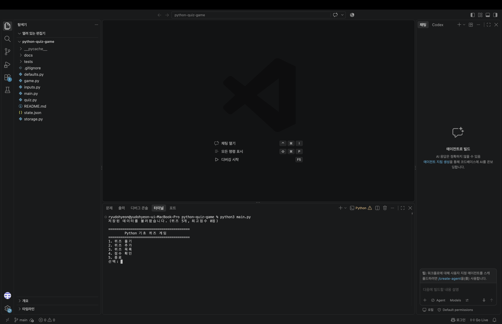

### 기본 문제 목록
추가하기 전 기본 문제 5개입니다.
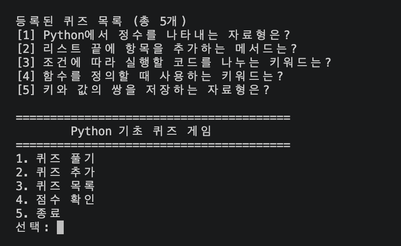

### 퀴즈 추가와 파일 저장
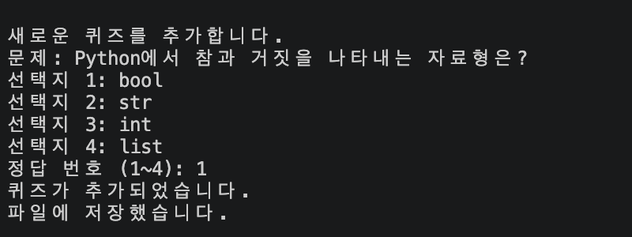

### 랜덤 출제와 정답·오답 판정
목록의 두 번째 문제인 리스트 문제가 마지막에 출제되는 등 원래 목록과 다른 순서로 출제됩니다.
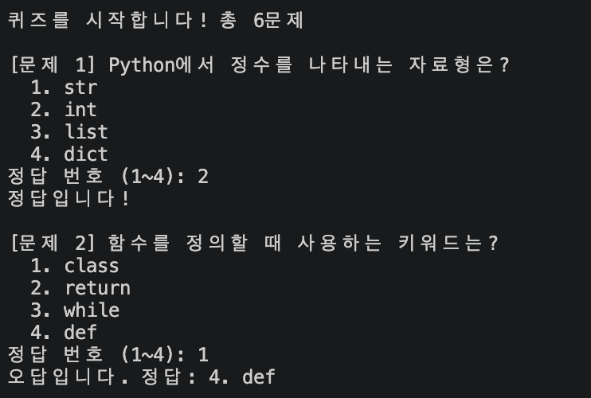
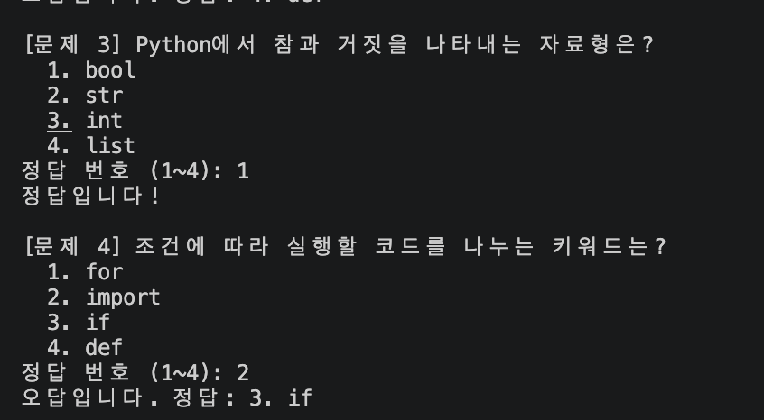

### 최종 결과
6문제 중 2개 정답으로 33점을 기록했습니다.
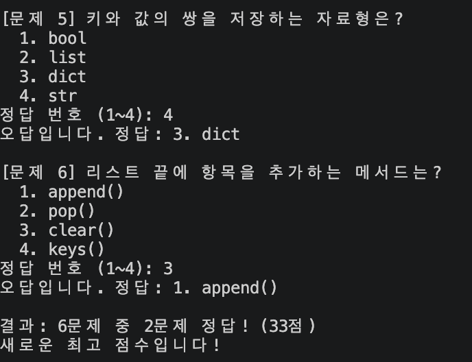

### 최고 점수 확인
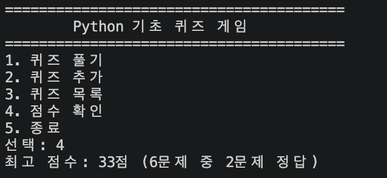

### 종료 후 재실행
추가한 문제를 포함한 6개 문제와 최고 점수 33점이 유지됩니다.
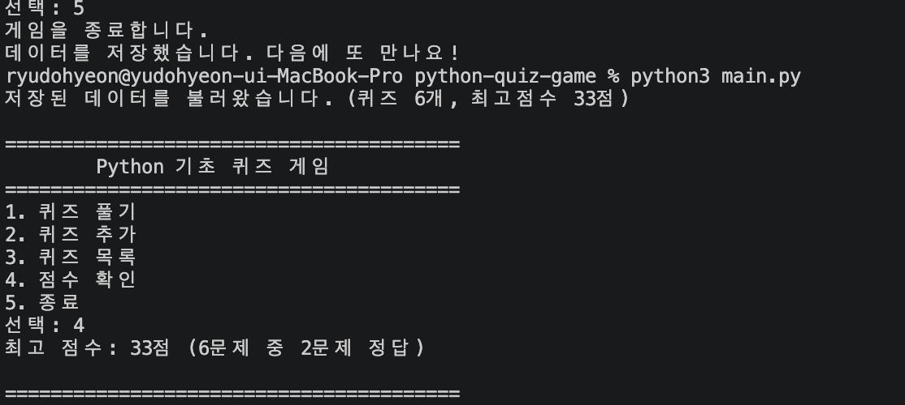

### 개발 환경
Python 3.14.6, Git 2.55.0과 Git 사용자 설정을 확인했습니다.
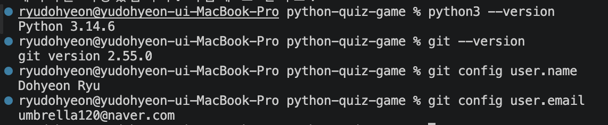

### Git 커밋과 브랜치 병합 기록
캡처 시점의 커밋 15개와 `feature/quiz-play` 브랜치의 생성·병합을 확인할 수 있습니다. 이후 자료 추가 커밋은 이 이미지에 포함되지 않습니다.
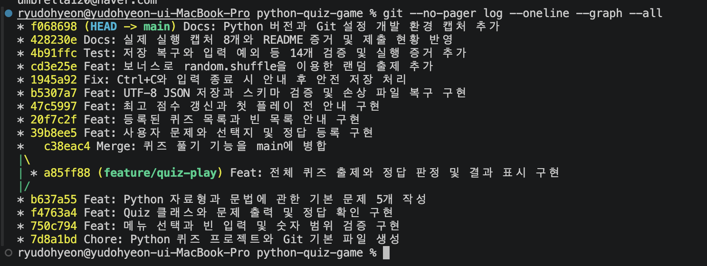

캡처: 2026-11-04 21:29:17 KST, 당시 main에서 도달 가능한 커밋 15개. 상단 `f068698`의 커밋 시각은 2026-11-04 21:27:49 +09:00이며, 이후 추가한 커밋은 이미지에 없습니다. `feature/quiz-play`의 `a85ff88`은 출제·정답 판정·결과 표시 구현이고, `c38eac4`는 이를 main에 합친 병합 커밋입니다. 커밋 시각과 개수는 아래 명령으로 현재 이력에서 확인할 수 있습니다.

```sh
git log --format="%h %cI %s" --all
git rev-list --count HEAD
```

자동 테스트 로그와 실제 실행 캡처는 별도로 관리합니다. 이 README에는 실제로 존재하는 이미지 파일만 연결했습니다.

GitHub 복제 실습을 완료했습니다.


## GitHub 업로드와 clone/pull 실습 증거

### main 및 기능 브랜치 업로드 (2026-11-04)
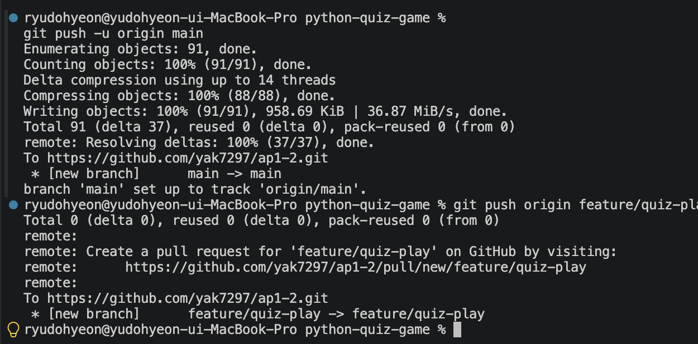

### 별도 폴더로 clone (2026-11-08)
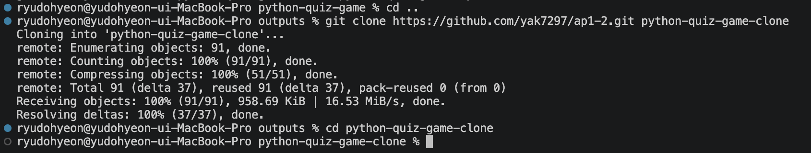

### 복제본에서 README 수정, commit, push
복제 폴더에서 확인 문구를 추가하고 `b671389` 커밋을 만든 뒤 원격 main에 반영했습니다.
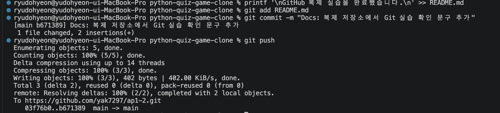

### 원래 폴더에서 pull 및 반영 확인
`git pull --ff-only`로 `03f76b0`에서 `b671389`로 이동했습니다. `git log -1`과 `tail -3 README.md`로 같은 커밋 및 추가 문구를 확인했습니다.
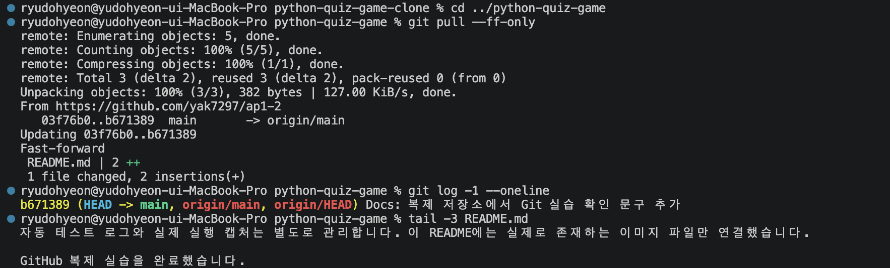
